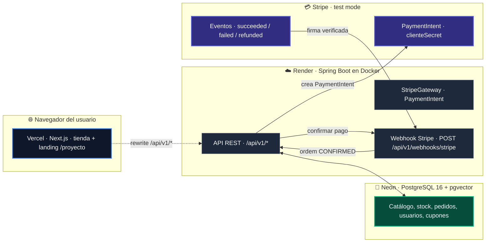
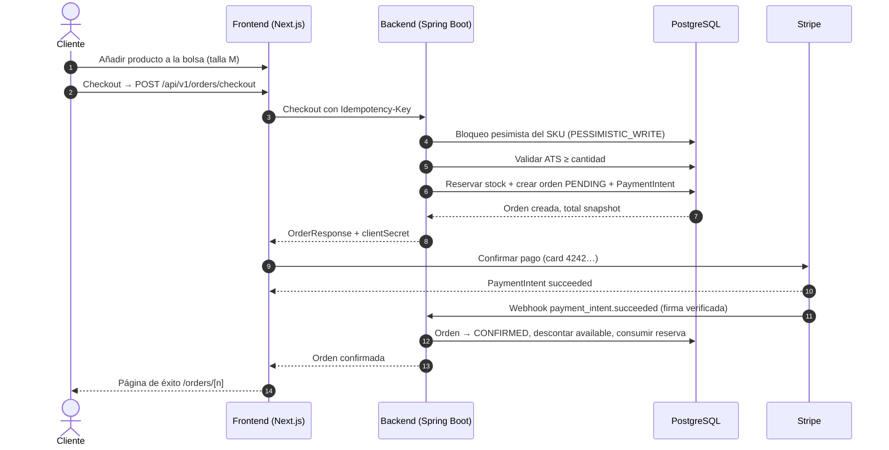

# Arquitectura de Nexus Commerce Core

Documentación técnica de referencia para el despliegue en producción (Vercel + Render + Neon) y los flujos clave del sistema. Los diagramas en Mermaid se renderizan directamente en GitHub.

---

## 1. Topología de despliegue

El navegador **sólo habla con el dominio de Vercel**; el frontend reescribe `/api/v1/*` al backend de Render mediante un proxy, por lo que **no hay CORS** (ADR-0004).



### Proveedores y responsabilidades

| Capa | Proveedor | Plan | Qué aloja |
|:---|:---|:---|:---|
| Frontend | **Vercel** | Hobby (gratis) | Next.js App Router, landing `/proyecto`, assets estáticos (`public/landing/`) |
| Backend | **Render** | Free web service | Imagen Docker multi-etapa (JDK 21 JRE), Spring Boot, perfiles `prod,demo` |
| Base de datos | **Neon** | Free | PostgreSQL 16 + pgvector, 0,5 GB, migraciones Flyway `V1…V23` + `R__demo_data.sql` |
| Pagos | **Stripe** | Test mode | `sk_test_…` / `pk_test_…`, webhook firmado hacia `…/api/v1/webhooks/stripe` |

---

## 2. Capas del backend

Arquitectura en capas con separación estricta: los controllers nunca contienen lógica de negocio, los servicios son transaccionales, y las entidades JPA nunca se exponen al exterior (solo DTOs inmutables tipo Java `record`).

```mermaid
flowchart TD
    Client[🌐 HTTP Client / Frontend Next.js]
    
    subgraph Core ["Nexus Commerce Core Backend (Spring Boot 3.4, Java 21)"]
        Controllers[Controllers · REST API<br/>• Validación @Valid<br/>• DTO Records inmutables<br/>• Manejo de errores RFC 7807]
        Services[Services · Lógica de Dominio<br/>• Transacciones @Transactional<br/>• Motor de precios BigDecimal<br/>• ATS y concurrencia de inventario<br/>• StripeGateway aísla la red]
        Repositories[Repositories · Persistencia<br/>• Spring Data JPA<br/>• JOIN FETCH (sin N+1)<br/>• Bloqueo pesimista FOR UPDATE]
        SpringAI[Spring AI · Enriquecimiento<br/>• gpt-4o-mini · Structured Outputs]
    end

    DB[("🐘 PostgreSQL 16 + pgvector<br/>• Migraciones Flyway<br/>• Extensión pgvector")]

    Client --> Controllers
    Controllers --> Services
    Services --> Repositories
    Services --> SpringAI
    Repositories --> DB

    classDef client fill:#0f172a,stroke:#3b82f6,stroke-width:2px,color:#f8fafc;
    classDef box fill:#1e293b,stroke:#475569,stroke-width:1px,color:#f8fafc;
    classDef ai fill:#312e81,stroke:#6366f1,stroke-width:2px,color:#f8fafc;
    classDef db fill:#064e3b,stroke:#10b981,stroke-width:2px,color:#f8fafc;

    class Client client;
    class Controllers,Services,Repositories box;
    class SpringAI ai;
    class DB db;
```

**Directrices técnicas obligatorias:**
- **Inmutabilidad y DTOs:** las entidades JPA nunca se exponen al exterior.
- **Aritmética financiera:** `BigDecimal` + `RoundingMode.HALF_UP`, nunca `double`/`float`.
- **Concurrencia de inventario:** bloqueo pesimista (`SELECT … FOR UPDATE`) para evitar over-selling.
- **Idempotencia del checkout:** cabecera `Idempotency-Key` obligatoria + `UNIQUE` en BD.

---

## 3. Flujo de checkout

El checkout es transaccional: reserva de stock y creación de la orden en una misma transacción con bloqueo pesimista.



**Notas:**
- El `clientSecret` **no se persiste ni se loguea**; se pide a Stripe por `GET /orders/{n}/payment`.
- Una clave `sk_live_…` hace fallar el arranque: solo test mode.

---

## 4. Flujo de pago con webhook de Stripe

El webhook es la **fuente de verdad**: una orden solo pasa a `CONFIRMED` con `payment_intent.succeeded` verificado por firma sobre el cuerpo crudo.

```mermaid
flowchart TD
    subgraph Stripe [Stripe · test mode]
        PI[PaymentIntent creado<br/>clienteSecret → frontend]
        EV[Evento payment_intent.succeeded]
    end

    subgraph Backend [Render · Spring Boot]
        WH[Webhook controller<br/>POST /api/v1/webhooks/stripe]
        Sig[Verificación de firma<br/>sobre cuerpo crudo + whsec_]
        TX[Servicio de orden<br/>@Transactional + PESSIMISTIC_WRITE]
    end

    subgraph DB [Neon · PostgreSQL]
        Orders[Tabla orders<br/>status, paymentStatus]
        Events[Tabla stripe_events<br/>PK idempotente]
    end

    PI -->|clienteSecret| Frontend[🌐 Frontend<br/>confirma pago con tarjeta]
    Frontend -->|pago exitoso| EV
    EV -->|HTTP POST| WH
    WH -->|firma válida?| Sig
    Sig -- no --> Reject[400 · sin efecto]
    Sig -- sí -->|INSERT … ON CONFLICT DO NOTHING| Events
    Events -- duplicado --> Ignored[Ignorado · idempotente]
    Events -- nuevo --> TX
    TX -->|PENDING → CONFIRMED| Orders
    TX -->|descontar stock available| Stock[Tabla stock_items]
```

**Capas de idempotencia:**
1. Cabecera `Idempotency-Key` en el checkout (cliente).
2. `UNIQUE` en BD contra duplicados.
3. Idempotency key de Stripe en el PaymentIntent.
4. Tabla `stripe_events` por PK (`INSERT … ON CONFLICT DO NOTHING`).

---

## 5. Métricas de calidad (medidas, no impuestas)

| Métrica | Valor | Fuente |
|:---|:---|:---|
| Tests backend | 553 | `./mvnw test` |
| Tests frontend | 606 | `npx vitest run` |
| E2E rápido | 33/33 | Playwright (Chromium) |
| axe (accesibilidad) | 18/18 | 14 rutas, sólo Chromium |
| Lighthouse | 5/5 rutas verdes | `/proyecto` incluida |
| Cobertura backend | 83,88 / 78,87 / 81,48 / 85,9 | JaCoCo (línea/rama/clase/metodo) |
| tsc / ESLint / build | 0 / 0 / 0 | Frontend |

---

## 6. Referencias

- [ADR-0001] Core architecture, concurrencia de inventario y precisión financiera
- [ADR-0002] Búsqueda semántica híbrida con pgvector
- [ADR-0003] Motor transaccional de pedidos, snapshot fiscal e idempotencia
- [ADR-0004] Arquitectura frontend, rewrite proxy e idempotencia en cliente
- [ADR-0005] Estrategia de testing en frontend
- [ADR-0006] Control de acceso basado en roles (RBAC)
- [ADR-0007] Pagos con Stripe: gateway aislado y webhook como fuente de verdad
- [ADR-0008] Despliegue en Vercel + Render + Neon, proxy por rewrite y modo demo

Todos los ADR en [`docs/adr/`](docs/adr/).
